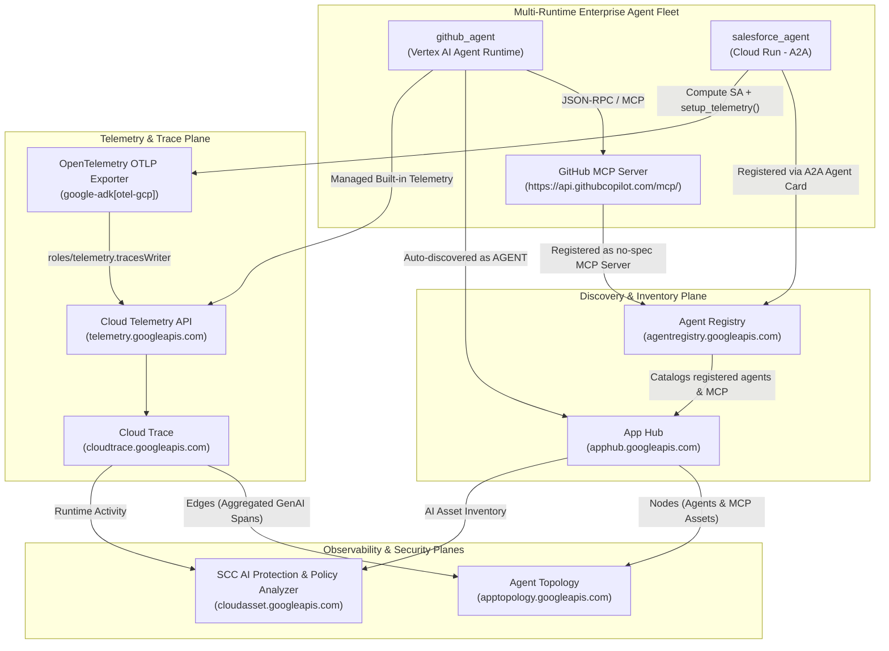

# Enterprise Agent Observability, Topology & Security Command Center AI Protection

## Overview & Summary

This repository and guide document the end-to-end configuration of **Observability (Cloud Trace)**, **Discovery (App Hub & Agent Registry)**, **Agent Topology**, and **Security Command Center (SCC) AI Protection** for a multi-runtime enterprise ADK agent fleet on Google Cloud.

### Key Objectives Accomplished

| Task | Objective | Runtime / Service | Status |
| :--- | :--- | :--- | :--- |
| **Task 1** | Prepare environment, deploy baseline agent fleet, install `google-agents-cli`, and enable Observability & Discovery APIs | Vertex AI Agent Runtime, Cloud Run, Service Usage | Completed |
| **Task 2** | Configure OpenTelemetry trace export (`roles/telemetry.tracesWriter`) and emit GenAI spans (`agent_run`, `call_llm`, `execute_tool`) | Cloud Trace, Telemetry OTLP API (`telemetry.googleapis.com`) | Completed |
| **Task 3** | Verify automatic discovery and `AGENT` functional classification of Agent Runtime workloads | Agent Registry, App Hub | Completed |
| **Task 4** | Grant Discovery Engine invoker access, fetch A2A agent card, and register the Cloud Run `salesforce-agent` | Cloud Run, Discovery Engine, Agent Registry | Completed |
| **Task 5** | Register the external GitHub MCP server (`github-mcp`) with `JSONRPC` binding | Agent Registry, App Hub | Completed |
| **Task 6** | Inspect multi-runtime relationships in the Agent Topology graph | Agent Registry Topology, Cloud Trace | Completed |
| **Task 7 & 8** | Review AI inventory in SCC AI Protection, simulate excessive permissions (`roles/editor`), and analyze blast radius | SCC AI Protection, IAM Policy Analyzer | Completed |
| **Task 9** | Remediate over-privileged service account and verify least-privilege IAM bindings | Cloud IAM | Completed |

---

## System Architecture

The architecture connects a multi-runtime agent fleet (`github_agent` on Vertex AI Agent Runtime and `salesforce_agent` on Cloud Run) with two platform planes:
1. **Discovery & Inventory Plane (Agent Registry + App Hub)** — identifies which resources are agents and MCP servers.
2. **Telemetry Plane (OpenTelemetry + Telemetry OTLP API + Cloud Trace)** — captures runtime execution spans (`agent_run`, `call_llm`, `execute_tool`) to build edges in **Agent Topology** and surface posture/threat insights in **Security Command Center AI Protection**.



---

## Complete Step-by-Step Commands by Task

### Task 1: Prepare Your Environment

#### 1.1 Set Project, Location, and Organization Variables

```bash
export PROJECT_ID=qwiklabs-gcp-01-f0bb0019d301
export LOCATION=us-central1
gcloud config set project ${PROJECT_ID}
export PROJECT_NUMBER=$(gcloud projects describe ${PROJECT_ID} --format='value(projectNumber)')
export ORGANIZATION_ID=$(gcloud projects get-ancestors ${PROJECT_ID} --format=json | jq -r '.[] | select(.type=="organization") | .id')
echo "Project: ${PROJECT_ID} (${PROJECT_NUMBER}), Org: ${ORGANIZATION_ID}, Location: ${LOCATION}"
```

#### 1.2 Copy Pre-Staged Lab Scripts, Agent Code, and IDE Settings

```bash
# Copy prerequisite scripts from the project bucket
gcloud storage cp -r gs://${PROJECT_ID}-bucket/apex_labs .

# Run the prerequisite script to deploy the baseline fleet (github-agent & salesforce-agent)
bash apex_labs/lab2_prereqs.sh

# Copy agent source code and VS Code settings
gcloud storage cp -r gs://${PROJECT_ID}-bucket/agents .
mkdir -p ~/.vscode
gcloud storage cp -r gs://${PROJECT_ID}-bucket/settings.json ~/.vscode/
```

#### 1.3 Install and Upgrade `google-agents-cli`

```bash
export PATH="${HOME}/.local/bin:${PATH}"
uvx google-agents-cli setup
uv tool upgrade google-agents-cli
agents-cli info
```

#### 1.4 Confirm the Agent Fleet is Running

```bash
# Verify salesforce-agent on Cloud Run
gcloud run services list \
  --project=${PROJECT_ID} \
  --region=${LOCATION} \
  --format="table(metadata.name)"

# Verify github-agent on Vertex AI Agent Runtime (Reasoning Engines)
curl -s -H "Authorization: Bearer $(gcloud auth print-access-token)" \
  "https://${LOCATION}-aiplatform.googleapis.com/v1/projects/${PROJECT_ID}/locations/${LOCATION}/reasoningEngines" \
  | jq -r '(.reasoningEngines // [])[] | "\(.displayName)\t\(.name)"'
```

#### 1.5 Enable Observability and Discovery APIs

```bash
gcloud services enable \
  observability.googleapis.com \
  cloudtrace.googleapis.com \
  telemetry.googleapis.com \
  apphub.googleapis.com \
  apptopology.googleapis.com \
  agentregistry.googleapis.com \
  cloudasset.googleapis.com \
  monitoring.googleapis.com \
  logging.googleapis.com \
  --project=${PROJECT_ID}
```

---

### Task 2: Export Traces to Cloud Trace

#### 2.1 Verify OpenTelemetry Instrumentation in Agent Code

Each agent includes `google-adk[gcp,otel-gcp]` and `opentelemetry-instrumentation-google-genai` in `pyproject.toml`, and configures the GCP trace exporter in `app/app_utils/telemetry.py`:

```bash
grep -E "google-adk|opentelemetry" ~/agents/salesforce-agent/pyproject.toml
cat ~/agents/salesforce-agent/app/app_utils/telemetry.py
```

Key exporter configuration in `app/app_utils/telemetry.py`:
```python
otel_hooks = get_gcp_exporters(
    enable_cloud_tracing=True,
    enable_cloud_metrics=False,
    enable_cloud_logging=True,
    google_auth=(credentials, project_id),
)
```

#### 2.2 Grant the Cloud Telemetry Traces Writer Role

Agent Runtime agents export traces via managed built-in telemetry, while Cloud Run agents export as their runtime service account (here, the Compute Engine default service account `${PROJECT_NUMBER}-compute@developer.gserviceaccount.com`):

```bash
export SF_SA=$(gcloud run services describe salesforce-agent \
  --region=${LOCATION} \
  --project=${PROJECT_ID} \
  --format='value(spec.template.spec.serviceAccountName)')

# Fallback to Compute Engine default service account if not explicitly set on the spec
if [ -z "${SF_SA}" ]; then
  export SF_SA="${PROJECT_NUMBER}-compute@developer.gserviceaccount.com"
fi

gcloud projects add-iam-policy-binding ${PROJECT_ID} \
  --member="serviceAccount:${SF_SA}" \
  --role="roles/telemetry.tracesWriter" \
  --condition=None
```

#### 2.3 Generate Traffic to Emit Traces

Find the `github-agent` Reasoning Engine resource URL (without `:query`) and invoke it via `agents-cli run`:

```bash
export GITHUB_AGENT_URL=$(curl -s -H "Authorization: Bearer $(gcloud auth print-access-token)" \
  "https://${LOCATION}-aiplatform.googleapis.com/v1/projects/${PROJECT_ID}/locations/${LOCATION}/reasoningEngines" \
  | jq -r '.reasoningEngines[] | select(.displayName=="github-agent") | "https://'"${LOCATION}"'-aiplatform.googleapis.com/v1/\(.name)"')

echo "Querying: ${GITHUB_AGENT_URL}"
agents-cli run \
  --url "${GITHUB_AGENT_URL}" \
  --mode adk \
  --app-name app \
  "Hello, what tools and capabilities do you have?"
```

---

### Task 3: Confirm Agent Runtime Agents Are Auto-Discovered

#### 3.1 List Agents in Agent Registry

```bash
gcloud alpha agent-registry agents list \
  --location=${LOCATION} \
  --project=${PROJECT_ID} \
  --format="table(displayName)"
```

#### 3.2 Verify App Hub Classifies the Reasoning Engine Workload as `AGENT`

```bash
export TOKEN=$(gcloud auth print-access-token)
curl -s -H "Authorization: Bearer ${TOKEN}" \
  -H "x-goog-user-project: ${PROJECT_ID}" \
  "https://apphub.googleapis.com/v1/projects/${PROJECT_ID}/locations/${LOCATION}/discoveredWorkloads" \
  | jq -r '.discoveredWorkloads[] | "\(.workloadProperties.functionalType.type // "-")\t\(.workloadReference.uri)"'
```

Expected output:
```text
AGENT	//aiplatform.googleapis.com/projects/811003490858/locations/us-central1/reasoningEngines/908471757327826944
```

---

### Task 4: Register the Cloud Run Agent (`salesforce-agent`)

#### 4.1 Provision Discovery Engine Service Identity and Grant Cloud Run Invoker Role

```bash
# Create the Discovery Engine service agent
gcloud beta services identity create \
  --service=discoveryengine.googleapis.com \
  --project=${PROJECT_ID}

# Grant roles/run.invoker on salesforce-agent to the Discovery Engine service agent
gcloud run services add-iam-policy-binding salesforce-agent \
  --region=${LOCATION} \
  --project=${PROJECT_ID} \
  --member="serviceAccount:service-${PROJECT_NUMBER}@gcp-sa-discoveryengine.iam.gserviceaccount.com" \
  --role="roles/run.invoker"
```

#### 4.2 Download the A2A Agent Card and Register `salesforce-agent` in Agent Registry

```bash
export SF_URL=$(gcloud run services describe salesforce-agent \
  --region=${LOCATION} \
  --project=${PROJECT_ID} \
  --format='value(status.url)')
export TOKEN=$(gcloud auth print-identity-token)

curl -s -H "Authorization: Bearer ${TOKEN}" \
  "${SF_URL}/a2a/app/.well-known/agent-card.json" -o salesforce_card.json

gcloud alpha agent-registry services create salesforce-agent \
  --location=${LOCATION} \
  --project=${PROJECT_ID} \
  --display-name="salesforce-agent" \
  --agent-spec-type=a2a-agent-card \
  --agent-spec-content="$(cat salesforce_card.json)"
```

---

### Task 5: Register the GitHub MCP Server

#### 5.1 Create the `github-mcp` Service in Agent Registry

```bash
gcloud alpha agent-registry services create github-mcp \
  --location=${LOCATION} \
  --project=${PROJECT_ID} \
  --display-name="github-mcp" \
  --mcp-server-spec-type=no-spec \
  --interfaces="url=https://api.githubcopilot.com/mcp/,protocolBinding=JSONRPC"
```

#### 5.2 Confirm MCP Server Registration

```bash
gcloud alpha agent-registry mcp-servers list \
  --location=${LOCATION} \
  --project=${PROJECT_ID}
```

---

### Task 6: View the Agent Topology Graph

1. In the Google Cloud Console, navigate to **Agent Platform > Agent Registry**.
2. Select project `${PROJECT_ID}`.
3. On the **Agents** tab, select `github-agent` (or `salesforce_agent`) and open the **Topology** tab.
4. To verify trace ingestion in the meantime, open **Monitoring > Trace explorer** and filter by span name `call_llm` or `agent_run`.

---

### Task 7 & Task 8: Simulate Excessive Permissions & Analyze Scope

#### 7.1 (Simulation) Grant `roles/editor` to the Cloud Run Agent Service Account

```bash
export SF_SA=$(gcloud run services describe salesforce-agent \
  --region=${LOCATION} \
  --format='value(spec.template.spec.serviceAccountName)')

gcloud projects add-iam-policy-binding ${PROJECT_ID} \
  --member="serviceAccount:${SF_SA}" \
  --role="roles/editor" \
  --condition=None
```

#### 7.2 Inspect Scope via Console & CLI

- **Console**: Navigate to **Agent Platform > Agents > Security** (`https://console.cloud.google.com/agent-platform/security`) and **IAM & Admin > Policy Analyzer** (query principal `${SF_SA}`).
- **CLI**: Inspect all roles bound to `${SF_SA}`:

```bash
echo ${SF_SA}
gcloud projects get-iam-policy ${PROJECT_ID} \
  --flatten="bindings[].members" \
  --filter="bindings.members:${SF_SA}" \
  --format="value(bindings.role)"
```

---

### Task 9: Fix Over-Privilege and Verify Least Privilege

#### 9.1 Confirm Required Narrow Roles Are Present

Ensure `${SF_SA}` retains only the four required operational roles:
- `roles/aiplatform.user`
- `roles/telemetry.tracesWriter`
- `roles/logging.logWriter`
- `roles/cloudtrace.agent`

```bash
for role in roles/aiplatform.user roles/telemetry.tracesWriter roles/logging.logWriter roles/cloudtrace.agent; do
  gcloud projects add-iam-policy-binding ${PROJECT_ID} \
    --member="serviceAccount:${SF_SA}" \
    --role="${role}" \
    --condition=None >/dev/null
done
```

#### 9.2 Remove the Broad `roles/editor` Role

```bash
gcloud projects remove-iam-policy-binding ${PROJECT_ID} \
  --member="serviceAccount:${SF_SA}" \
  --role="roles/editor"
```

#### 9.3 Verify `roles/editor` Is Removed

```bash
# Should return empty output
gcloud projects get-iam-policy ${PROJECT_ID} \
  --flatten="bindings[].members" \
  --filter="bindings.members:${SF_SA} AND bindings.role:roles/editor" \
  --format="value(bindings.role)"

# Confirm only the 4 narrow roles remain
gcloud projects get-iam-policy ${PROJECT_ID} \
  --flatten="bindings[].members" \
  --filter="bindings.members:${SF_SA}" \
  --format="value(bindings.role)"
```
